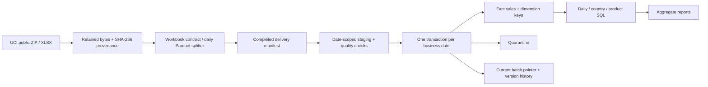
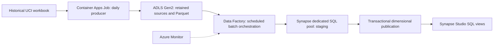

# Retail Revenue Warehouse

**A locally tested daily retail ELT implementation with an Azure Synapse dedicated-pool target.** A historical workbook becomes traceable daily Parquet deliveries, a dimensional warehouse and signed sales metrics. Repeat deliveries leave facts unchanged; a corrected delivery replaces only its selected business date.

> **Delivery stage:** the local Python/DuckDB pipeline is runnable without a cloud subscription. Azure infrastructure, producer and SQL assets are included, but Azure deployment, security, performance and recovery are **not validated**. This repository does not claim a production deployment. Actual checks and data results are recorded in [VALIDATION.md](docs/VALIDATION.md).

## Problem and relevance

Revenue reports become unreliable when a repeated file doubles sales, a cancellation is dropped, a missing customer removes a valid transaction, or a revised daily load exposes incomplete data. This project addresses those concrete failure modes with explicit physical row identity, signed decimal amounts, an Unknown customer member and transactional publication by business date.

The [ONS retail release of 23 October 2026](https://www.ons.gov.uk/businessindustryandtrade/retailindustry/bulletins/retailsales/september2026) provides current context for online retail reporting and revisions. Our dataset is deliberately **historical: one retailer, December 2010–December 2011**. The daily arrivals are simulated from invoice dates; there is no live sales feed or claim about today's market. [Sources, attribution and reuse terms](docs/SOURCES.md).

## Architecture



The selected Azure architecture is preserved as the deployment target:



| Component | Why it is used | Validation boundary |
|---|---|---|
| Python + openpyxl | Stream a real workbook, preserve Excel row identity, normalize source types | Executed locally |
| PyArrow + Parquet | Typed daily deliveries with checksums and columnar storage | Executed locally |
| DuckDB + SQL | Reproducible local transactions, star schema and analytical SQL | Local substitute; not a Synapse emulator |
| Container Apps Job + ADLS | Azure producer and durable daily handoff | Cloud code supplied; not deployed |
| ADF + Synapse **dedicated SQL pool** | Orchestration, warehouse staging, date-level publication and serving | Cloud SQL/provider behavior not executed |
| Bicep + Azure DevOps | Infrastructure definitions and explicit deployment controls | Offline checks only |
| unittest + GitHub Actions | Regression, failure and replay checks without cloud credentials | Actual results in validation record |

The Azure runbook records bootstrap requirements, remaining integration gaps, monitoring, pause/cleanup steps and the approval needed before costs: [AZURE.md](docs/AZURE.md).

## Run locally

Use Python 3.12 or 3.14. Commands run from the repository root on macOS/Linux or Windows WSL. Dependencies are pinned in `pyproject.toml`.

```bash
python3 -m venv .venv
source .venv/bin/activate
python -m pip install .
python -W error::ResourceWarning -m unittest discover -s tests -v

# Invented fixture: use its own warehouse, separate from the real source.
python scripts/generate_fixture.py --output data/fixtures/synthetic-retail.xlsx
retail-warehouse split --file data/fixtures/synthetic-retail.xlsx --data-dir data/demo
retail-warehouse load --data-dir data/demo
retail-warehouse report --data-dir data/demo

# Public historical workbook: download, retain and split into simulated dates.
retail-warehouse fetch --data-dir data/live
retail-warehouse load --data-dir data/live
retail-warehouse report --data-dir data/live
python scripts/run_queries.py --data-dir data/live

# A seven-calendar-date backfill; only source dates present in the interval load.
retail-warehouse load --data-dir data/live --start 2010-12-01 --end 2010-12-07
```

The network fetch is bounded and unauthenticated. Synthetic tests and SQL against an existing warehouse are offline. A repeated selected batch returns a replay result; audit events may accumulate, but previously published facts do not multiply. Keep one writer per warehouse. Date-level transactions mean a multi-date backfill can be partially complete when a later date fails; rerun the same interval to resume.

## Engineering choices that matter

- **Physical grain:** workbook SHA-256 + worksheet row number. Invoice + product is not unique; identical source lines remain distinct. A row in a corrected workbook has new provenance even when some business values match.
- **Currency:** GBP unit prices retain four decimal places. Multiply by signed integer quantity, then round the line to pennies using half-away-from-zero rounding. Rounding the unit price to pennies first can lose real small-price values.
- **Signed amounts:** positive line values, negative adjustments and zero-value lines remain visible; net is positive plus negative. A C-prefixed invoice is also recorded, but the pipeline does not invent links between cancellations and original purchases. Negative prices are retained and flagged for investigation.
- **Dimensions:** missing customers map to Unknown. Product descriptions are observed attributes rather than an authoritative master catalogue; versions preserve changes without relabelling historical facts.
- **Corrections:** new delivery versions replace selected dates in a transaction. Retained raw data and batch manifests make replay possible. An old superseded source requires an explicit reversion option.
- **Quality:** structural source problems stop splitting; compatible invalid rows are quarantined by date. Every staged row must be accounted for as a fact or a rejected row. Tests inject failures while a date is being replaced.

See [DATA_MODEL.md](docs/DATA_MODEL.md) for exact field types, keys, rounding, missingness and warning semantics; [OPERATIONS.md](docs/OPERATIONS.md) for recovery and operational limits. Useful SQL is committed under [sql/](sql/); inspectable observed aggregates are under [examples/](examples/).

## Validation and interpretation

The validation record distinguishes deterministic tests, the full-workbook public-source smoke, independent decimal reconciliation, replay and infrastructure compilation from cloud tests that have not run. An independent [source oracle](scripts/source_oracle.py) reads the original XLSX directly with Python Decimal, without importing the warehouse or consuming generated Parquet.

Observed result: **541,909 source rows across 305 dates**, with all daily signed totals independently reconciled to the penny. The pipeline retained 135,080 lines with missing customers and 5,268 candidate duplicates. The signed total was **GBP 9,747,747.93**. **42 local tests passed**; full replay and a seven-calendar-date backfill preserved business state. [Exact evidence and limits](docs/VALIDATION.md).

This source includes administrative/non-product stock codes, negative quantities, zero prices and missing customer identifiers. Keeping these visible makes the reported net a **signed transaction-line total**, not audited financial revenue, profit, cash collected or a count of unique orders. There are no costs, tax-policy adjustments, currency conversion, confirmed refund links or customer identity verification. Do not calculate margin from this source.

## Interview talking points

1. **Why not use invoice + stock code as a primary key?** A real invoice can contain repeated product lines. The source file and worksheet position give reproducible physical identity without deleting evidence.
2. **Why keep negative values?** Cancellations and adjustments affect signed totals; blanket positive-only cleaning biases the result. Flags support investigation without guessing each row's cause.
3. **Why an Unknown customer?** A missing dimension attribute should not erase an otherwise valid sale. Unknown-customer coverage is reported explicitly.
4. **How is a correction published?** Stage and validate the selected day, replace its facts/quarantine and active pointer within one transaction, and retain the original version for replay.
5. **What does incremental mean here?** Work is selected and committed by business date. It is simulated batch delivery from a workbook, not CDC or a streaming source.
6. **What still prevents a cloud production claim?** Synapse runtime/IAM/network validation, real ingestion and recovery tests, measured cost/performance, concurrency controls and operational ownership. Compiled templates do not establish those properties.

Original code: MIT. UCI source and derived observations: CC BY 4.0, credited to Daqing Chen. See [SOURCES.md](docs/SOURCES.md).
