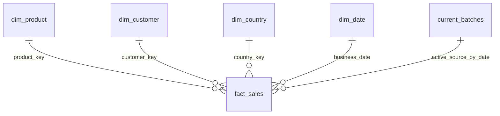

# Schema and metric contract

Local contract: `retail-invoice-v1`. An incompatible existing warehouse requires a reviewed migration or a separate data directory. The typed daily Parquet schema is `BATCH_SCHEMA` in `src/retail_warehouse/pipeline.py`; the Azure adapter maps it to a separate versioned Synapse contract.

## Source and delivery grain

One workbook has exactly one worksheet and eight ordered columns: `InvoiceNo`, `StockCode`, `Description`, `Quantity`, `InvoiceDate`, `UnitPrice`, `CustomerID`, `Country`. A physical record is identified by **workbook SHA-256 and its Excel worksheet row number**, starting at 2 for the first data row. The single-sheet requirement makes this key unambiguous. Invoice numbers and product codes are attributes, not unique fact keys.

The splitter retains original workbook bytes and creates a daily Parquet file for each observed invoice date. Daily delivery is simulated; it is not the source's original delivery cadence. Each completed manifest records date, file path, digest and raw/accepted/quarantine counts. A completed source pointer is published after splitting finishes. An invalid date rejects the workbook because that row cannot be assigned honestly to a daily batch. Header changes, multiple worksheets and an empty source also stop publication.

| Source field | Normalization | Invalid or missing handling |
|---|---|---|
| InvoiceNo | Text, or integral numeric ID converted to text; whitespace stripped | Missing/invalid required identifier quarantines; C prefix retained as cancellation flag |
| StockCode | Same identifier handling, including legitimate alphabetic administrative codes | No invented five-digit-only restriction; missing/invalid quarantines |
| Description | String representation, stripped; empty becomes null | Missing is allowed; observed value participates in product version identity |
| Quantity | Finite signed integer in supported BIGINT range | Fractional, missing, boolean or out-of-range values quarantine; zero/negative values remain |
| InvoiceDate | Native timezone-naive Excel datetime | Required for partitioning; a missing, string, formula or timezone-aware value rejects the workbook |
| UnitPrice | Finite `DECIMAL(18,4)`, half-away-from-zero rounding to four places | Missing, boolean, nonfinite or out-of-range values quarantine; zero/negative values remain |
| CustomerID | Positive integer when supplied | Null maps to Unknown; an invalid supplied ID quarantines |
| Country | Canonical nonempty text/integral identifier representation | Missing/invalid quarantines; country names are source labels, not ISO-verified codes |

Formula expressions are never evaluated. A leading `=` in required identifier fields is invalid. Required numeric formulas are invalid numbers; description text is preserved as literal text. Timestamps retain recorded local civil values without assigning a timezone or making a UTC event-time claim.

Rejection reasons are `invalid_invoice_no`, `invalid_stock_code`, `invalid_country`, `invalid_quantity`, `invalid_unit_price`, `invalid_customer_id` and `line_amount_overflow`. Multiple reasons may refer to one row. Quarantine retains row identity, reasons and a JSON rendering of original values; the XLSX remains the exact-byte source of truth. All-quarantined batches are allowed and expose zero accepted metrics, so successful execution is not by itself a quality threshold.

## Dimensional warehouse

| Object | Grain/key | Purpose |
|---|---|---|
| `workbook_sources` | Source SHA | Source URL, first local capture time, byte count, sheet, source row count, retained paths; includes historical published versions |
| `batch_versions` | Business date + source SHA | First committed counts and Parquet digest for every published daily version |
| `current_batches` | Business date | One active source SHA per business date |
| `fact_sales` | Date + source SHA + physical worksheet row | Invoice, dimension keys, recorded time, signed quantity, decimal price/amount, classifications and flags |
| `quarantine` | Same physical row key | Reasons and raw-value JSON for current rejected records |
| `dim_product` | SHA-256 of canonical JSON `[stock_code, description]` | Immutable observed attribute versions; not an inferred effective-dated product master |
| `dim_customer` | Positive source customer ID, or 0 | Key 0 represents Unknown and has null source customer ID |
| `dim_country` | SHA-256 of canonical JSON country label | Source-country dimension without external enrichment |
| `dim_date` | Business date | Calendar year/month/day for published dates |
| `run_audit` | Generated run UUID per date attempt | Start/end UTC, source, date, status, replay flag and error class |
| `daily_revenue` | Business date + country key | Current facts aggregated into signed measures and quality/coverage flags |
| `quality_summary` | Date + rejection reason | Count of current rejected rows exhibiting each reason |
| `current_batch_versions` | Current date/version | Pointer joined to committed version metadata |

Primary keys enforce local physical identity. `(customer_key, business_date)` supports customer/date inspection. Foreign-key relationships are logical and verified by validation; the local DDL does not declare foreign-key constraints. Direct writes outside the pipeline are unsupported. Dimensions preserve historical observed values even when no current fact references them. Hash keys are deterministic content keys, not secrets or a promise of mathematically impossible collisions.

## Monetary and counting definitions

`line_amount = ROUND_HALF_AWAY_FROM_ZERO(quantity × unit_price_4dp, 2)` as `DECIMAL(18,2)`. The multiplication precedes penny rounding. Source prices have up to three decimal places in the observed workbook; four-place storage preserves those values. Decimal overflow quarantines the line. GBP is assumed from the source dictionary for all countries; no exchange-rate conversion is applied.

| Metric or flag | Definition |
|---|---|
| Positive sales | Sum of rounded line amounts greater than zero |
| Negative adjustments | Signed sum of rounded line amounts less than zero |
| Net revenue / signed total | Sum of all rounded line amounts; equals positive sales + negative adjustments. The column name is not a claim of audited revenue recognition |
| Zero-value lines | Count of rounded line amounts equal to zero; retained, including very small values that round to zero |
| Cancellation | Normalized invoice starts with C, case-insensitive |
| Cancellation sign mismatch | Cancellation flag differs from `quantity < 0`; an investigation flag, not proof of an error |
| Negative price | Normalized unit price is below zero; retained, not automatically called a refund |
| Unknown customer lines | Accepted facts referencing customer key 0 |
| Candidate duplicate | For equal invoice/product/customer/country/time/quantity/price/amount/cancellation values within a daily batch, flag occurrences after the first (`n−1`) without deleting any |
| Invoice count | Distinct invoice number **within the query's date/country/filter grain**; do not sum grouped counts as a universal unique-order count |

The project does not infer cancellation-to-original links, tax treatments, cost of goods, margins, customer identities or true unique purchases. Repeated lines are source observations. Three exact decimal measures are reconciled independently from the original workbook for every observed business date.

## History and publication

The current fact/quarantine tables retain the active version per published date. Raw workbooks, daily delivery files and version metadata retain previous evidence. This is current-state serving with reconstructible input history, not full bitemporal storage or a complete log of activation intervals. Capture/commit timestamps are local UTC observations, not original source publication times.

A date-range load commits dates independently. A revised workbook can therefore coexist with an older source on dates outside the selected range. A range that omits a previously published date inside it fails rather than silently deleting that day. Dates outside the chosen range are unaffected. Empty source dates are not implicit deletion commands.
